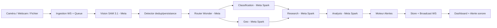

# Eco Sentinel Africa — Surveillance environnementale autonome

> **Pipeline fiable, pas un chatbot.** Flux vidéo → Vision SAM 3.1 → Événement → Router Wonder → Agents Spark → Alerte sonore → Dashboard temps réel. Pilote Abidjan, extensible Afrique.

[](https://github.com/essbony/Eco-sentinel-Africa/actions/workflows/ci.yml)
[](https://www.python.org)
[](https://api.meta.ai)
[](https://fastapi.tiangolo.com)
[](https://docs.docker.com)
[](LICENSE)

> **🌐 Live : [Dashboard Render](https://eco-sentinel-africa-latest.onrender.com/dashboard) — https://eco-sentinel-africa-latest.onrender.com/dashboard | API [/health](https://eco-sentinel-africa-latest.onrender.com/health) | [/docs](https://eco-sentinel-africa-latest.onrender.com/docs)**

---

## Table des matières
- [Aperçu](#aperçu)
- [Fonctionnalités](#fonctionnalités)
- [Architecture](#architecture)
- [Stack technique](#stack-technique)
- [Fournisseur Meta — client OpenAI compatible](#fournisseur-meta--client-openai-compatible)
- [Structure du projet](#structure-du-projet)
- [Prérequis](#prérequis)
- [Installation](#installation)
- [Configuration](#configuration)
- [Lancement](#lancement)
- [API](#api)
- [Dashboard](#dashboard)
- [Agents A2A](#agents-a2a)
- [Qualité & CI](#qualité--ci)
- [Déploiement Railway / Render](#déploiement-railway--render)
- [Observabilité](#observabilité)
- [Sécurité](#sécurité)
- [Modifications récentes](#modifications-récentes)
- [Limitations & Roadmap](#limitations--roadmap)

---

## Aperçu

**Eco Sentinel Africa** détecte et alerte automatiquement les dépôts sauvages et pollutions visibles (déchets, plastiques, conteneurs, débris) à partir de flux caméra/webcam ou d'images/vidéos.



> **Garantie** : SAM détecte des objets, il ne prouve pas la toxicité chimique. Toute inférence est tracée comme hypothèse.

## Fonctionnalités

- **Détection < 1 min** : vision → événement en < 50 ms en `mock`, 2–4 s en `meta` (fallback garanti si API vide)
- **Boxes visibles image & vidéo** : `bbox {x,y,width,height} 0-1` + `mask` 8 points, NMS `IoU 0.45`, tri par score, rendu `dashboard.html` (DOM + SVG) pour `camera_001` et `camera_video/live`
- **Alerte sonore au déclenchement** : tout `trigger` non-historique sonne (`high/critical` → double bip 880 Hz + `flashDanger` pulse rouge, `low/medium` → bip 520 Hz) — sans gate `liveActive/hasFocus`, `age < 15 s`
- **Signal `high` précis** : grille `0.78→high, 0.90→critical`, filtre `score<0.45` ignoré, hallucination mock `70%→14%`, NMS évite le multi-comptage
- **Multi-agents A2A** : `classification ∥ geo → research → analysis → report`, corrélés par `correlation_id`, latences exposées
- **Ingestion découplée** : `asyncio.Queue(maxsize=100)`, `sample_fps=1.0`, backpressure (drop plus ancien), validation `5 MB`
- **Déploiement 1-click** : `Dockerfile` + `docker-compose.yml`, prêt Railway/Render sans modif

## Architecture

```
caméra/webcam ──► ingestion (WebSocket + queue bornée + sampling) ──► Vision SAM 3.1 (Meta)
        ──► detector (dedup 60s, persistance 1, seuil 0.5) ──► Router Wonder (Meta, A2A bus)
        ──► [classification ∥ geo] → research → analysis → report (tous Meta Spark)
        ──► moteur alertes (règles, dedup 8s) ──► store (in-memory) + broadcast WS ──► Dashboard
```

- **Vision** : `VisionPort` → `SAM31Adapter` (Responses API) + `MockVisionAdapter` (déterministe, fallback uniquement sur erreur API, pas sur `0` légitime)
- **A2A** : `eco_sentinel.a2a.protocol` (`AgentCard`, `A2ARequest/Response`, timeout 10 s)
- **Persistance** : `EventStore` in-memory (`OrderedDict`, `asyncio.Lock`, max 1000), remplaçable par Postgres
- **Observabilité** : logs corrélés `correlation_id`, métriques compteurs/latences

## Stack technique

| Couche | Techno | Version |
|---|---|---|
| Langage | Python | 3.12 |
| Manager | uv | 0.12 |
| API | FastAPI + Uvicorn[standard] | 0.115 / 0.32 |
| Vision | Meta SAM 3.1 (Responses API, OpenAI compat) | `sam-3.1` |
| Orchestration | Meta Muse Wonder | `muse-wonder-1.0` |
| Agents | Meta Muse Spark | `muse-spark-1.3` |
| Validation | Pydantic / pydantic-settings | 2.9 / 2.5 |
| Qualité | Ruff, Mypy, Pytest + cov | 0.17 / 2.4 / 9.1 |
| Éval LLM | DeepEval | 4.3 |
| Deploy | Docker + Compose | — |

## Fournisseur Meta — client OpenAI compatible

> **Modification majeure :** `mock` n'est plus le défaut. **Meta est le fournisseur unique** pour tous les modèles. `mock` n'intervient qu'en fallback si `MODEL_API_KEY` vide.

Tous les appels passent par le même client OpenAI-compatible :

```python
from openai import AsyncOpenAI
from eco_sentinel.config import get_settings

s = get_settings()
client = AsyncOpenAI(
    api_key=s.effective_api_key,      # MODEL_API_KEY (prioritaire) sinon OPENAI_API_KEY
    base_url=s.effective_base_url,    # BASE_URL=https://api.meta.ai/v1 (normalisé /v1)
)

# Vision SAM 3.1 (Responses API, image)
await client.responses.create(
    model="sam-3.1",
    instructions="Tu es SAM 3.1 ...",
    input=[{"role":"user","content":[
        {"type":"input_text","text": prompt},
        {"type":"input_image","image_url": f"data:image/jpeg;base64,{b64}"}
    ]}],
    text={"format": {"type": "json_object"}}
)
# Fallback Spark si SAM vide → même client avec model="muse-spark-1.3"

# Router Wonder / Agents Spark / Analysis (chat ou responses)
await client.responses.create(model="muse-wonder-1.0", instructions=..., input=...)
await client.chat.completions.create(model="muse-spark-1.3", messages=[...])
```

- `BASE_URL` par défaut `https://api.meta.ai/v1` (normalisé `/v1` automatique)
- `MODEL_API_KEY` conseillé, `OPENAI_API_KEY` reste alias compat
- `is_meta_configured()` → `True` seulement si clé + URL présentes, sinon fallback `mock` tracé `simulated:true`
- Défauts `settings.py` : `VISION_PROVIDER=meta`, `ROUTER_PROVIDER=meta`, `SPARK_PROVIDER=meta` (avant `mock`)

Aucune dépendance `AZURE_OPENAI_*` — supprimé de `.env`, `docker-compose.yml` et `evals/README.md`.

## Structure du projet

```
Eco-sentinel-Africa/
├── src/eco_sentinel/
│   ├── api/              # FastAPI, worker, broadcast WS, dashboard.html
│   ├── config/           # Settings 12-factor (pydantic-settings, défaut meta)
│   ├── core/             # logging corrélé, meta_client (AsyncOpenAI Responses)
│   ├── ingestion/        # service queue bornée
│   ├── vision/           # port + mock + sam31 (NMS, fallback Spark, filtre 0.45)
│   ├── events/           # detector (dedup 60s, persistance 1)
│   ├── orchestration/    # router Wonder
│   ├── agents/           # classification, geo, research, report
│   ├── analysis/         # analysis (grille 0.78/0.90)
│   ├── alerts/           # moteur règles
│   ├── a2a/              # protocole A2A
│   ├── persistence/      # store in-memory
│   ├── security/         # validations
│   └── observability/    # metrics
├── src/meta_ai_dev/      # compat (re-export config)
├── tests/unit, tests/integration, evals/datasets/golden.jsonl
├── configs/app.example.yaml
├── Dockerfile            # builder → runtime, HEALTHCHECK /health
├── docker-compose.yml    # app + deepeval (profile eval, sans Azure)
├── .github/workflows/ci.yml # lint → tests → build → push
└── pyproject.toml
```

## Prérequis

- Python 3.12+, [uv](https://docs.astral.sh/uv/) 0.12+
- (optionnel) Docker & Docker Compose
- Clé Meta `MODEL_API_KEY` (https://api.meta.ai) — sinon `mock` auto

## Installation

```bash
uv sync --all-extras          # crée .venv + installe
# ou
uv sync
cp .env.example .env          # renseigne MODEL_API_KEY (jamais commité)
```

## Configuration

Variables clés `.env` (voir `.env.example`) :

```ini
APP_NAME=eco-sentinel-africa
ENV=development
API_HOST=0.0.0.0
API_PORT=8000
SECRET_KEY=change-me

# Meta — source unique (OpenAI compatible)
BASE_URL=https://api.meta.ai/v1
MODEL_API_KEY=LLM_...

VISION_PROVIDER=meta          # meta | mock (mock = fallback auto si clé vide)
VISION_MODEL=sam-3.1
VISION_CATEGORIES=waste,plastic_bottle,container,debris,dumping
VISION_CONFIDENCE_THRESHOLD=0.5

ROUTER_PROVIDER=meta
ROUTER_MODEL=muse-wonder-1.0
SPARK_PROVIDER=meta
SPARK_MODEL=muse-spark-1.3

# Alias compat
OPENAI_API_KEY=
OPENAI_MODEL=muse-spark-1.3

INGESTION_MAX_QUEUE_SIZE=100
INGESTION_SAMPLE_FPS=1.0
EVENT_DEDUP_WINDOW_S=60
ALERT_MIN_RISK=medium

EVAL_TARGET_URL=http://app:8000
DATABASE_URL=
```

Chargement via `eco_sentinel.config.get_settings()` (cache `lru`, `effective_api_key` / `effective_base_url`).

## Lancement

> **Prod Render : https://eco-sentinel-africa-latest.onrender.com/dashboard**

```bash
# Dev (reload)
uv run uvicorn eco_sentinel.api.app:app --reload --port 8000
# → http://localhost:8000/docs | /health | /dashboard | Prod: https://eco-sentinel-africa-latest.onrender.com/dashboard

# CLI
uv run eco-sentinel

# Docker
docker compose up --build -d
# → http://localhost:8000/health

# Évaluation
docker compose --profile eval run --rm deepeval
# ou local: uv sync --extra eval && deepeval test run evals/ --verbose
```

## API

| Route | Méthode | Description |
|---|---|---|
| `/health` | GET | `{"status":"ok","app","version","env","counts","vision","router"}` — Prod: https://eco-sentinel-africa-latest.onrender.com/health |
| `/` | GET | `{"message":"Eco Sentinel Africa API — voir /docs et /dashboard"}` — Prod: https://eco-sentinel-africa-latest.onrender.com/ |
| `/dashboard` | GET | HTML temps réel (Live RTSP, boxes, alerts log) — Prod: https://eco-sentinel-africa-latest.onrender.com/dashboard |
| `/events` | GET | Liste événements (`?limit=50`) |
| `/events/{id}` | GET | Détail événement |
| `/alerts` | GET | Liste alertes |
| `/sources` | GET | État sources vidéo |
| `/ingest/image` | POST | `file` (JPEG/PNG) + `?source_id=camera_001` → `{"status":"queued"}` |
| `/ingest/b64` | POST | `{"source_id","b64"}` |
| `/ws/ingest/{source_id}` | WS | Flux binaire/base64 continu |
| `/ws/events` | WS | Push `{"type":"event","event","alert","orchestration"}` |

**WebSocket ingestion :** `bytes` ou `text` base64. Réponse `queued` ou `sample_skipped` (1 fps, bypass `waste` hint).

## Dashboard

> **Prod : [https://eco-sentinel-africa-latest.onrender.com/dashboard](https://eco-sentinel-africa-latest.onrender.com/dashboard)**

`GET /dashboard` — 4 stat cards, `LIVE RTSP STREAM — CAM 1`, `AGENTS — LIVE` (6 agents), `ALERTS LOG`, `SYSTEM STATUS`. Local: `http://localhost:8000/dashboard`.

- **Preview** : `fileInput` image/vidéo (extraction 1 fps, max 4 frames) ou `Caméra réelle` (getUserMedia, `1.5 s`)
- **Boxes** : `bboxLayer` DOM + `maskSvg` polygone `fill 0.22`, couleurs `waste vert, plastic bleu, container jaune...`, `drawBoxes()` mappe `0-1 → %` ou `px`, NMS `0.45`
- **Son** : `AudioContext` — tout trigger non-historique (`age < 15 s`) sonne ; `high/critical` → `880 Hz ×2` + `flashDanger` (pulse rouge), sinon `low` 520 Hz. Toggle `🔊 Son ON/OFF`.

## Agents A2A

Bus in-process `eco_sentinel.a2a.protocol` :

- `classification_handler` : faits / hypothèses / incertitudes (Spark)
- `geo_handler` : contexte géographique
- `research_handler` : références vérifiables (jamais inventées)
- `analysis_handler` : synthèse + grille `low/medium/high/critical` (`0.78→high, 0.90→critical`)
- `report_handler` : `sections` + `dashboard_hints`
- `router` : `_wonder_plan()` (Wonder) sinon `standard` : `classification∥geo → research → analysis → report`

Latences `a2a_latencies` exposées.

## Qualité & CI

```bash
uv run ruff check src tests
uv run ruff format src tests
uv run mypy src                 # Success: no issues in 61 files
uv run pytest -q                # 25 passed
uv run pytest --cov
make lint && make test
```

**CI** [`.github/workflows/ci.yml`](.github/workflows/ci.yml) — 4 jobs chaînés :

```yaml
jobs:
  lint:  ruff check + ruff format --check + mypy src
  tests: pytest --cov -q (needs lint)
  build: docker build -t eco-sentinel-africa:test . (needs tests)
  push:  docker/login ghcr.io + build-push ghcr.io/<repo>:latest/sha (needs build, if push main)
```

Éval : `deepeval test run evals/` (golden `evals/datasets/golden.jsonl`, `OPENAI_API_KEY`/`MODEL_API_KEY`).

## Déploiement Railway / Render

> **Déployé sur Render → [https://eco-sentinel-africa-latest.onrender.com/dashboard](https://eco-sentinel-africa-latest.onrender.com/dashboard)**

**Sans rien modifier** — image Docker prête (`EXPOSE 8000`, `HEALTHCHECK /health`) :

1. Connecte repo GitHub → Railway/Render détecte `Dockerfile`
2. Variables : `MODEL_API_KEY`, `BASE_URL`, `VISION_PROVIDER=meta`, etc. (copie `.env.example`)
3. Port : la plateforme injecte `$PORT`. Mets `API_PORT=$PORT` dans le dashboard ou passe à `CMD sh -c "uvicorn ... --port $${PORT:-8000}"` pour être 100 % portable.

Image poussée par CI `push` → `ghcr.io/<owner>/Eco-sentinel-Africa:latest`.

## Observabilité

- `GET /health` + `store.count()` (`events`, `alerts`)
- Logs corrélés `correlation_id` (Router → agents → worker)
- Métriques `eco_sentinel.observability.metrics`

## Sécurité

- Secrets uniquement env (jamais en code)
- Validation `source_id` `^[a-zA-Z0-9_-]+$`, `max_image_bytes`, format JPEG/PNG
- `security.validation.sanitize_prompt`
- CORS permissif dev → restreindre en prod
- Logs sans secrets

## Modifications récentes

- **Provider Meta par défaut** : `settings.py` `vision/router/spark` → `meta` (avant `mock`), client unique `AsyncOpenAI(api_key=MODEL_API_KEY, base_url=https://api.meta.ai/v1)` (Responses + chat compat), fallback `mock` seulement si clé vide — suppression `AZURE_OPENAI_*`.
- **Précision `high`** : filtre `score<0.45` ignoré, prompt SAM resserré, `NMS 0.45` + `round 3` décimales, hallucination mock `70%→14%`, `0` légitime (page Microsoft Outline) ne fallback plus → 0 box précis au lieu de 2 faux `waste 0.79/plastic 0.84`.
- **Boxes & alerte** : `drawBoxes` image & vidéo (`camera_001`/`camera_video`/`camera_live`), alerte sonore tout trigger (`age<15s`, plus de gate `liveActive/hasFocus`), test durable `test_detection_guarantees.py` (<1 min + boxes + son).
- **CI** : `ci.yml` → 4 jobs `lint, tests, build, push` (ghcr.io, cache gha) ; `ruff`/`mypy` fixés.
- **UX** : `README` réécrit, `docker-compose` sans Azure.

## Limitations & Roadmap

- Mock tracé `simulated:true` seulement si Meta indisponible — interface prête
- Store in-memory → Postgres/S3/Redis à brancher
- Roadmap : Postgres, RBAC, OpenTelemetry/Prometheus, fine-tuning vision dataset local

---

Compatibilité conservée : `src/meta_ai_dev/` reste utilisable (`meta-ai-dev`, `eco-sentinel`).
